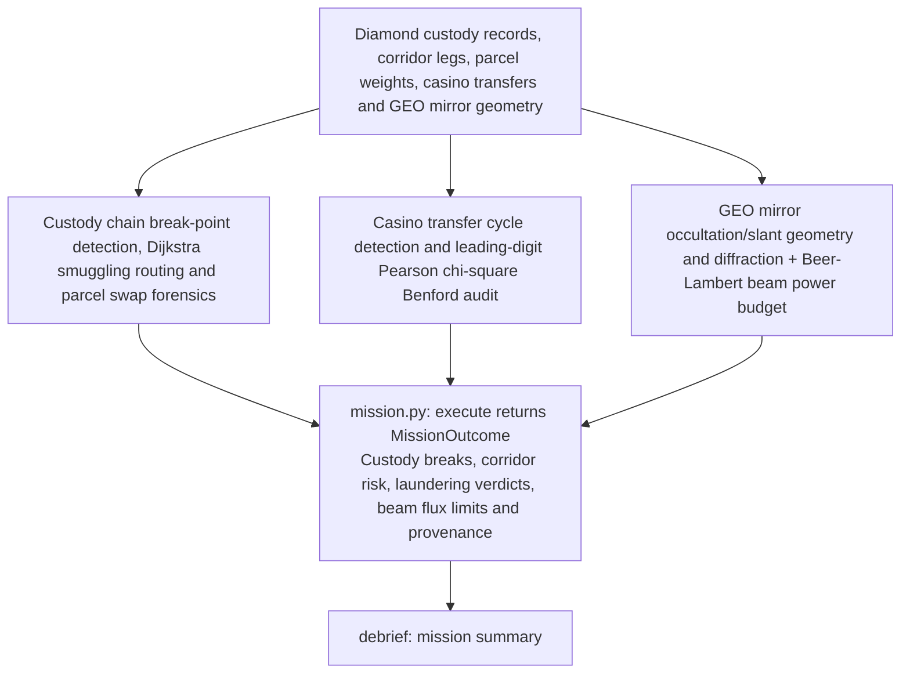

# Diamonds Are Forever — CONFLICT STONE · DIAMOND NET

See [package maintenance](docs/package-maintenance.md) for dependency and citation records.

Special-agent mission software for the BOND film package **Diamonds Are Forever
(1971)** — mission codename **CONFLICT STONE** (deepening phase: **DIAMOND
NET**).

## Mission model



The branches group implemented capabilities; they do not imply a runtime order.

**Source map:** [`provenance_chain.py`](src/diamonds_are_forever/provenance_chain.py), [`smuggling_routes.py`](src/diamonds_are_forever/smuggling_routes.py), [`lot_forensics.py`](src/diamonds_are_forever/lot_forensics.py); [`casino_network.py`](src/diamonds_are_forever/casino_network.py), [`benford_audit.py`](src/diamonds_are_forever/benford_audit.py); [`orbital_mirror.py`](src/diamonds_are_forever/orbital_mirror.py), [`beam_physics.py`](src/diamonds_are_forever/beam_physics.py); [`mission.py`](src/diamonds_are_forever/mission.py).

## The film as a specification

*Diamonds Are Forever* is one operation seen end to end: stones leave an
African mine without certification, move through a smuggling corridor to
Amsterdam and on to Las Vegas, get swapped and skimmed along the way, are
washed through a casino empire, and pay for an orbital mirror that threatens
cities from geostationary orbit. Each of those stages is a real analytic
problem, and this package implements one deterministic module per stage.

| Film concept | Module | What it computes |
|---|---|---|
| Conflict-goods provenance | `provenance_chain.py` | Custody graph, documented handoffs, break points, coverage, origin tracing |
| The smuggling corridor | `smuggling_routes.py` | Risk-weighted corridor network; expected-cost Dijkstra optimum vs. a fewest-hops BFS baseline; survival, exposure, reduction |
| Are the stones real? | `lot_forensics.py` | Weight-gain / excess-loss / density-mismatch audit with a clean/suspicious/flagrant verdict |
| The Las Vegas wash | `casino_network.py` | Directed transfer graph, gross/net flow, hub, money cycles, laundering closure |
| The books don't add up | `benford_audit.py` | Leading-digit Benford test with a Pearson chi-square verdict |
| Where can the mirror strike? | `orbital_mirror.py` | Occultation, slant range, elevation geometry |
| What does the beam deliver? | `beam_physics.py` | Diffraction spot, Beer-Lambert attenuation, power budget, vaporization dwell, minimum mirror diameter |

The last one is the point of the exercise: the film's weapon is bounded by
optics, and the module says by how much rather than taking the plot's word for
it.

Supporting modules: `mission.py` (the protocol adapter), `figures.py` (eight
deterministic PNGs), `manuscript_variables.py` (`{{TOKEN}}` hydration).

## The MissionProvider surface

`src/diamonds_are_forever/mission.py` implements the **frozen** `bond-api`
`MissionProvider` protocol, consumed as a local path dependency:

```python
class MissionProvider:
    film = "diamonds_are_forever"

    def brief(self) -> MissionBrief: ...              # 6 objectives, 6 assets, 2 constraints
    def recon(self, request: ReconRequest) -> ReconReport: ...
    def plan(self, brief: MissionBrief) -> MissionPlan: ...      # 7 steps, one per concept
    def execute(self, plan: MissionPlan) -> MissionOutcome: ...  # results + SHA-256 provenance
    def debrief(self, outcome: MissionOutcome) -> Debrief: ...   # 8 standing lessons
```

Alongside it, `register_gadgets(registry)` publishes eleven named callables
(`provenance.break_points`, `smuggling.route`, `forensics.audit`, `casino.hub`,
`benford.report`, `orbital.visible`, `beam.metrics`, …) into the Q-branch
registry. **This whole surface — the method signatures and the gadget names —
is frozen**: `bond-cli`, the coordinator's reconcile pass, and the orchestrator
consume it across packages. Deepening happens inside the methods.

The analytic cores stay **pure** (stdlib math, no `bond_api` or
`infrastructure` imports) so they remain importable and testable even if the
path dependency is unavailable.

## Results

Every number this package reports is computed at runtime from frozen canonical
datasets — the manuscript reads them through `{{TOKEN}}` injection and never
states one in prose. That deliberately includes model constants (the cutting
allowance, the density window, the Benford critical value, the strike
requirement), which are exported as named constants from their owning module.

This README therefore quotes no figures. To see the current ones:

```bash
uv run python scripts/run_mission.py --json     # the full mission outcome
uv run python scripts/z_generate_manuscript_variables.py
cat output/data/manuscript_variables.json       # every token and its live value
```

`data/claim_ledger.yaml` maps each headline claim to the exact call that
produces it.

## Usage

```bash
# Install (from this directory) — wires the bond-api path dependency.
uv sync --extra dev

# Full mission flow + round-trip JSON outcome.
uv run python scripts/run_mission.py
uv run python scripts/run_mission.py --json

# Per-phase CLIs.
uv run python scripts/brief.py
uv run python scripts/recon.py
uv run python scripts/plan.py
uv run python scripts/execute.py
uv run python scripts/debrief.py

# Regenerate figures and hydrate the manuscript tree.
uv run python scripts/generate_figures.py
uv run python scripts/z_generate_manuscript_variables.py
```

## Verification

```bash
uv run pytest tests/ --cov=src --cov-fail-under=90
uv run ruff check src/ scripts/
uv run ruff format --check src/ scripts/
uv run mypy src/ scripts/
```

The coverage gate is a 90% floor on `src/` (line + branch); the suite currently
sits well above it, and `--cov-fail-under=90` is the number that matters rather
than any figure quoted in prose. Zero mocks, zero skips.

Deterministic by construction: fixed canonical datasets, no RNG, and every
mission outcome carries a SHA-256 fingerprint of its inputs, so two runs
produce byte-identical debriefs. Manuscript hydration is deterministic on the
same footing — the edition stamp is `paper.date` from `manuscript/config.yaml`
rather than a clock reading, so regenerating `output/` rewrites the same bytes
(`PYTHON_VERSION` is the only token read from the machine, so byte-identity is
claimed for reruns on the same interpreter).

## Project layout

```
src/diamonds_are_forever/   pure core (7 modules) + mission adapter + figures + manifest vars
scripts/                    thin phase CLIs and generators
tests/                      deterministic tests (coverage-gated, zero mocks)
manuscript/                 config + numbered sections ({{TOKEN}}-driven)
docs/                       agent instructions, architecture, testing philosophy
data/claim_ledger.yaml      headline claims mapped to the calls that produce them
output/                     regenerated artifacts (figures, hydrated manuscript) — disposable
```

Start with [`docs/README.md`](docs/README.md) for the documentation index, or
[`docs/architecture.md`](docs/architecture.md) for the module-by-module design.
